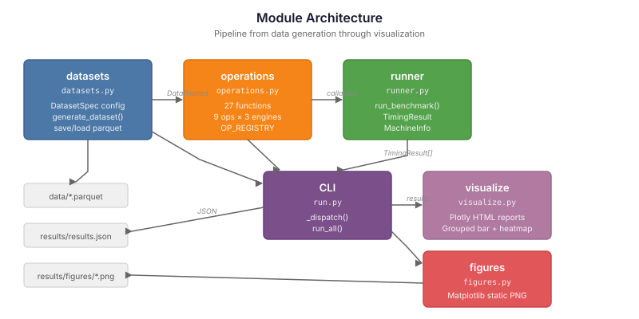

# Architecture

## Overview

A benchmark suite that measures Polars, pandas and DuckDB on identical operations, using scientific methodology to produce reproducible, comparable results.



```
datasets.py → operations.py → runner.py → run.py → visualize.py / figures.py
  generate       define         time       orchestrate     plot
```

## Modules

### datasets.py — Data generation

Creates deterministic datasets using NumPy and Faker with `seed=42`. Each `DatasetSpec` controls row count, key cardinality, and null presence. Datasets are written to Parquet and loaded into each engine's native format.

Nine specs cover the matrix: small/medium/large × low-card/high-card/nulls.

### operations.py — Benchmark operations

Each operation is implemented three times (one per engine) as a standalone function. Operations:

| Category | Operations |
|----------|-----------|
| Groupby | Low cardinality, high cardinality |
| Join | Inner, left, anti |
| Window | Rank, running sum |
| Filter + sort | Compound conditions |
| I/O | Parquet read |

DuckDB functions take a file path and query Parquet directly. Polars and pandas functions take DataFrames.

The `OP_REGISTRY` dict maps operation names to engine functions for dynamic dispatch.

### runner.py — Timing and measurement

`run_benchmark()` follows scientific benchmarking methodology:

1. **Warmup** rounds (default 2) to stabilize caches
2. **Timed rounds** (default 7) with GC disabled during each measurement
3. **Median + IQR** reported instead of mean (robust to outliers)

`MachineInfo` captures system specs (OS, CPU, RAM, Python version) for reproducibility.

`validate_answers()` checks that all engines produce the same row count for an operation.

### visualize.py — Plotly reports

Generates interactive HTML reports:

- **Grouped bar charts** per dataset size, with error bars (IQR/2)
- **Heatmap** across all datasets, operations and engines
- Machine specs shown as annotations

Results are also saved as JSON for further analysis.

### figures.py — Matplotlib static figures

Generates publication-ready static PNG figures:

- **Performance overview** — Grouped bar chart with log-scale y-axis, error bars (IQR/2), value annotations
- **Relative performance** — Normalized to fastest engine per operation (log scale)
- **Measurement variability** — Box plots showing distribution of individual round timings
- **Heatmap** — Operations × engines matrix with color-coded timing values

Uses colorblind-friendly palette consistent with the Plotly reports (Polars: `#4C78A8`, pandas: `#F58518`, DuckDB: `#54A24B`).

### run.py — CLI orchestration

`_dispatch()` routes each (operation, engine) pair to the correct function with the correct arguments. `functools.partial` binds the arguments for the timing loop.

The CLI supports `--size` (small/medium/large/all) and `--rounds` parameters.

## Design decisions

1. **Three separate implementations per operation** — No abstraction layer between engines. Each function is the idiomatic way to express that operation in that engine. This measures the engine, not a wrapper.

2. **DuckDB reads Parquet directly** — DuckDB's strength is querying files without loading them into memory. Benchmarking it via DataFrames would miss the point.

3. **Median + IQR over mean + stddev** — Benchmark times are right-skewed (GC pauses, background processes). Median is robust to these outliers.

4. **GC disabled during measurement** — Python's garbage collector adds noise. Disabling it during timed sections and collecting between rounds gives cleaner measurements.

5. **Deterministic seed throughout** — Same seed for NumPy and Faker means identical datasets across runs. Differences in results come from the engine, not the data.

6. **No pytest-benchmark dependency** — Custom timing code is simpler, gives us exactly the methodology we want, and avoids a transitive dependency.

7. **Log-scale visualization** — Benchmark results span multiple orders of magnitude. Log scale makes all operations comparable without outliers dominating the chart.

## Testing

23 tests across four modules:

- `test_datasets.py` — Determinism, row counts, null handling, cardinality, I/O
- `test_operations.py` — All operations produce results, engines agree on counts
- `test_runner.py` — Timing works, machine info populated, answer validation

Tests use small datasets (1K rows) for speed.
