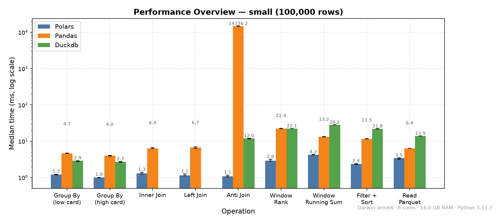
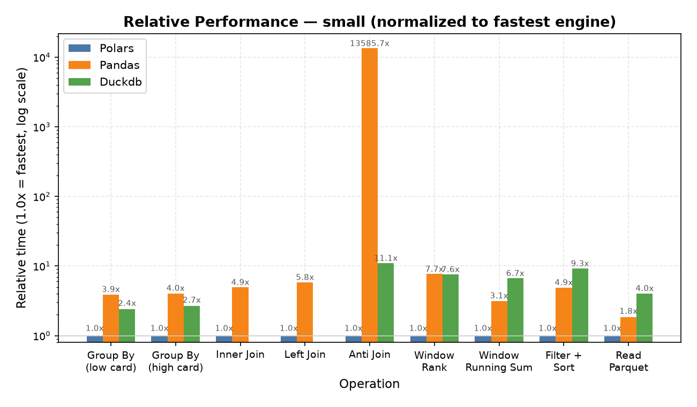
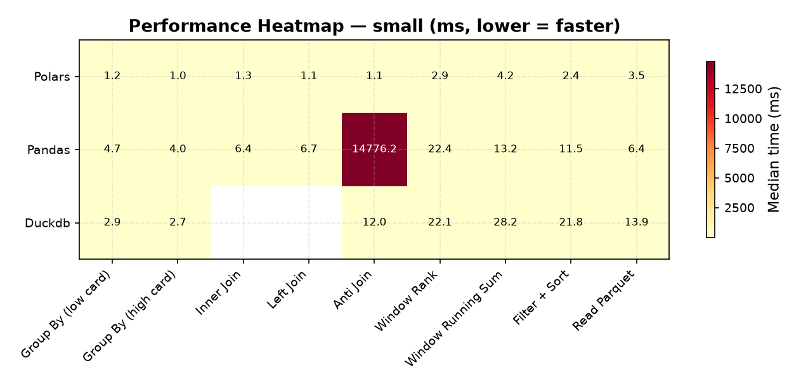
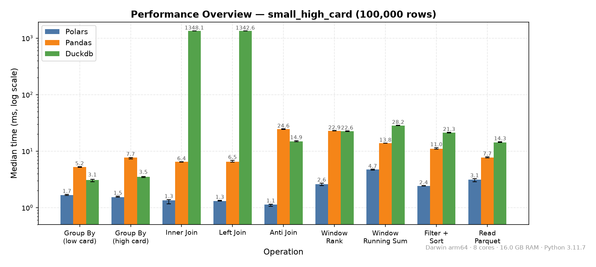
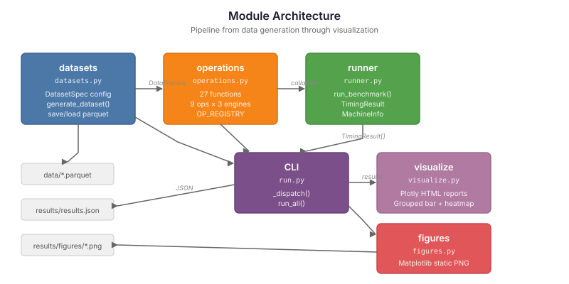

# Polars vs pandas vs DuckDB — Benchmark

[](https://github.com/tbsvendsen/polars-pandas-duckdb-benchmark/actions)
[](https://www.python.org/)
[](LICENSE)

Systematic performance comparison of three Python DataFrame engines across
9 common data operations. All benchmarks run locally on your machine with
deterministic data — no cloud, no API keys.

## Results

> Measured on Apple M1 (8 cores, 16 GB RAM), Python 3.11.7, 100,000 rows.

### Performance Overview



**Key findings:**
- **Polars is fastest** in every operation (1–4 ms range)
- **pandas anti-join is pathologically slow** (14.8s) — the `merge(..., indicator=True)` pattern does not scale
- **DuckDB excels at groupby** (faster than pandas) but lags on window functions due to SQL parsing overhead
- DuckDB inner/left joins on low-cardinality data hit memory limits on this machine (self-join CTE reads parquet twice)

### Relative Performance



Polars is the baseline (1.0x). pandas ranges from 1.8x to 13,500x slower depending on operation.
DuckDB ranges from 2.4x to 11x slower, with consistent performance across most operations.

### Performance Heatmap



### High Cardinality Results

With 10,000 distinct group keys (vs 20 in the standard dataset):



DuckDB joins become very slow (~1.3s) with high cardinality due to the `ROW_NUMBER() OVER()` CTE pattern.

## Methodology


Each operation is measured with:

| Parameter | Value | Rationale |
|-----------|-------|-----------|
| Warmup rounds | 2 | Primes JIT, caches, memory allocators |
| Timed rounds | 5 | Enough for stable median without excessive runtime |
| GC during timing | Disabled | Prevents collection pauses from distorting measurements |
| Timer | `time.perf_counter` | Highest resolution monotonic clock |
| Central tendency | Median | Robust to OS scheduling outliers |
| Error bars | Q1–Q3 | Asymmetric interquartile range around median |
| Data seed | 42 | Deterministic, reproducible across machines |

### Operations

| Operation | What it measures |
|-----------|-----------------|
| `groupby` | Aggregation over 20 groups (SUM, AVG, COUNT) |
| `groupby_high_card` | Same aggregation over N/10 groups |
| `join_inner` | Inner join with lookup table |
| `join_left` | Left join with lookup table |
| `join_anti` | Anti-join (rows not in exclude set) |
| `window_rank` | Rank within groups (ROW_NUMBER equivalent) |
| `window_running_sum` | Cumulative sum within groups |
| `filter_sort` | Filter on two columns + descending sort |
| `read_parquet` | Cold read from Parquet file |

### Dataset Variants

| Variant | Rows | Groups | Nulls |
|---------|------|--------|-------|
| `small` | 100,000 | 20 | No |
| `small_high_card` | 100,000 | 10,000 | No |

## Architecture



```
src/benchmark/
├── datasets.py      # DatasetSpec + generation (NumPy, Faker)
├── operations.py    # 27 functions (9 ops × 3 engines)
├── runner.py        # Timing harness (warmup, GC, stats)
├── run.py           # CLI entry point + dispatch
├── visualize.py     # Plotly HTML reports
└── figures.py       # Matplotlib static figures (PNG)
```

See [ARCHITECTURE.md](ARCHITECTURE.md) for design decisions.

## Quick Start

```bash
git clone https://github.com/tbsvendsen/polars-pandas-duckdb-benchmark.git
cd polars-pandas-duckdb-benchmark
python -m venv .venv && source .venv/bin/activate
pip install -e ".[dev]"
```

Run the benchmark:

```bash
python -m benchmark.run --size small --rounds 5
```

Results are saved to `results/results.json` with Plotly HTML reports.

Generate static figures:

```bash
python -c "from benchmark.figures import generate_all; from pathlib import Path; generate_all(Path('results/results.json'), Path('results/figures'))"
```

Run tests:

```bash
pytest
```

## Tech Stack

| Component | Library |
|-----------|---------|
| DataFrames | Polars ≥1.0, pandas ≥2.0 |
| SQL engine | DuckDB ≥1.0 |
| Parquet | PyArrow ≥14.0 |
| Data generation | NumPy, Faker |
| Static figures | Matplotlib ≥3.8 |
| Interactive reports | Plotly ≥5.18 |
| Testing | pytest, mypy (strict), ruff |

## Related Projects

- [medallion-template](https://github.com/tbsvendsen/medallion-template) — A data pipeline where the choice of DataFrame engine matters. Uses Polars.
- [duckdb-data-quality](https://github.com/tbsvendsen/duckdb-data-quality) — Data quality checks for DuckDB, one of the engines benchmarked here.

## License

MIT
